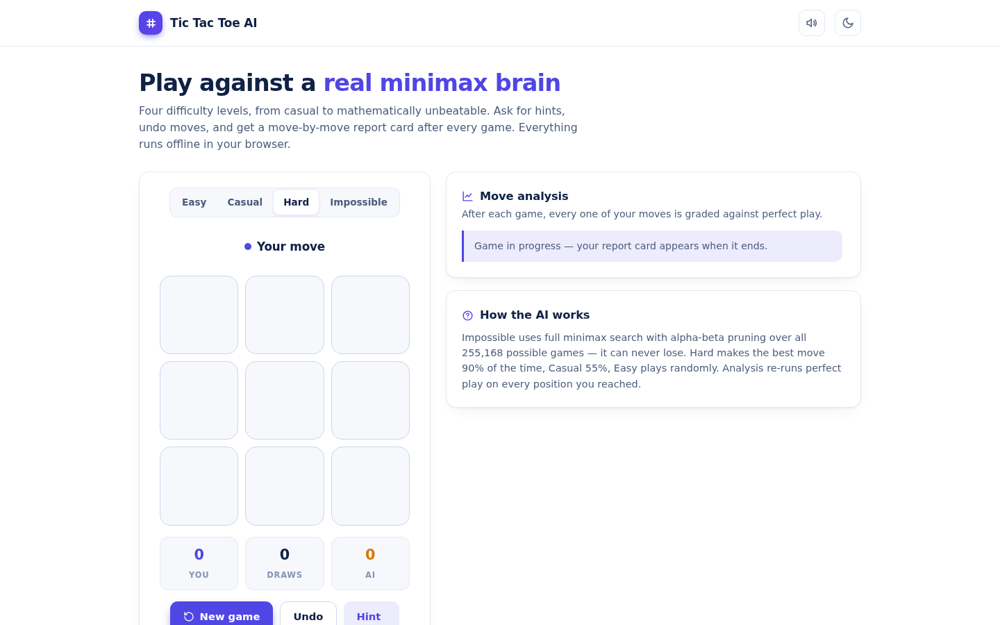
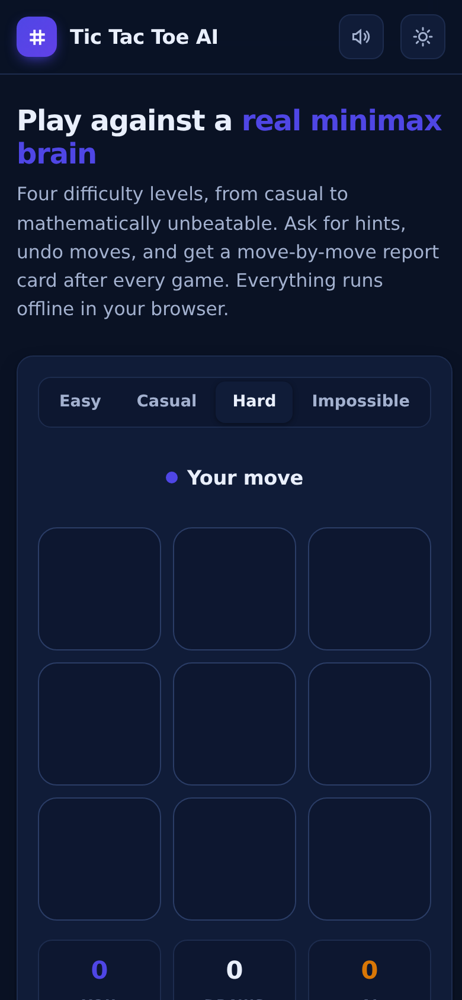

# Tic Tac Toe AI

Play tic-tac-toe against a real minimax brain. Four difficulty levels from casual to mathematically unbeatable, with hints, undo, move-by-move analysis and persistent score tracking.

**Live demo: https://akash991833.github.io/tic-tac-toe-ai/**



## Features

- **Unbeatable Impossible mode** - full minimax search with alpha-beta pruning over the complete game tree. It can never lose; the best you can do is draw.
- **4 difficulty levels** - Easy (random), Casual (55% best move), Hard (90% best move), Impossible (perfect play).
- **Move analysis** - after every game, each of your moves is graded Best / Good / Missed against perfect play, with the optimal cell named.
- **Hints** - highlights the strongest move in any position.
- **Undo** - takes back your last move and the AI's reply.
- **Score tracking** - wins, draws and losses persist in your browser.
- **Play as X or O**, keyboard controls (1-9, U undo, H hint, N new game), subtle sounds with a mute toggle.
- **Dark and light mode**, remembering your choice and following your system preference by default.
- **PWA**: installable, works fully offline after the first visit.



## How the AI works

Minimax explores every possible continuation of the current position, scoring terminal states as win / draw / loss and assuming both players play perfectly. Alpha-beta pruning skips branches that cannot change the result, so the full tree is searched instantly in the browser. The lower difficulties mix in random moves so the game stays fun.

## Tech

Vanilla HTML, CSS and JavaScript. No frameworks, no build step, no network calls, no tracking. Everything runs on your device.

## Run locally

Open `index.html` in a browser, or serve the folder:

```bash
python3 -m http.server 8000
# http://localhost:8000
```
